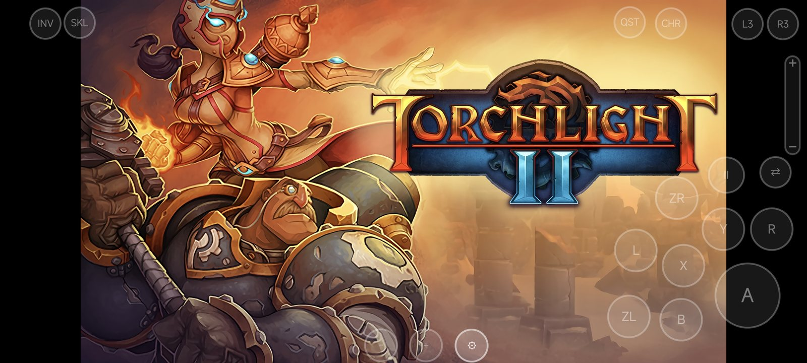
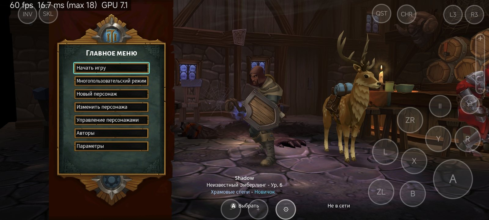
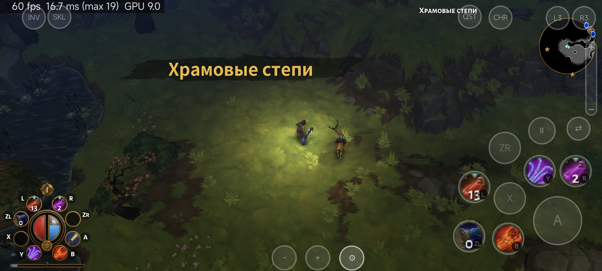
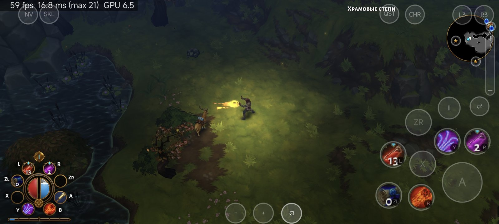
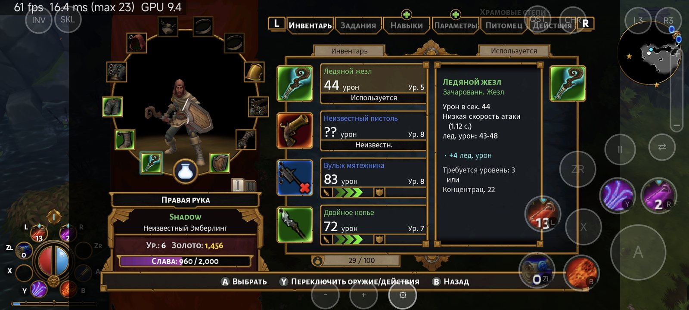
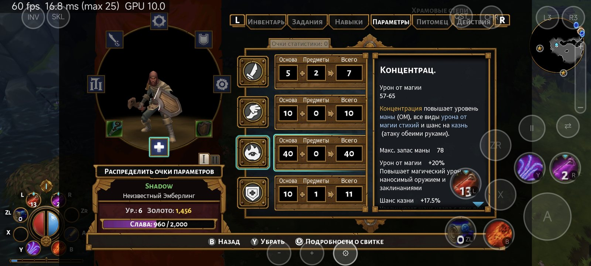
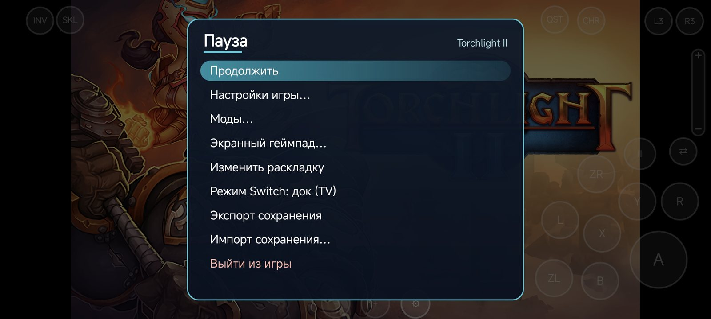
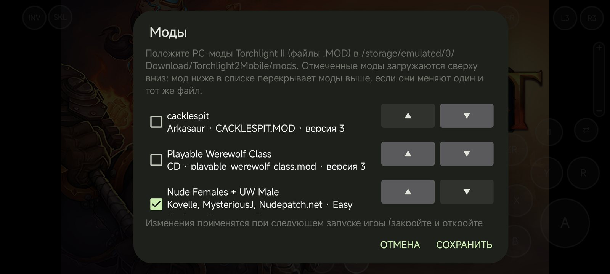

# Torchlight II Mobile

**A native Android port of Torchlight II for Nintendo Switch.** The game's own AArch64 program runs directly on the
phone's CPU; a small host provides the Switch system services (HLE of the `nn::` SDK), and the NVN graphics API is
replayed on Vulkan. You bring the game: this repository contains no game content and no keys.

Русский: [ниже](#по-русски).

**Install:** step-by-step guide for players — [docs/INSTALL.md](docs/INSTALL.md) (English) ·
[docs/INSTALL.ru.md](docs/INSTALL.ru.md) (по-русски). In short: dump your own game + update v327680 and `prod.keys`, put
them into `put-game-files-here/`, double-click `setup.bat` (or `bash setup.sh`), copy `work/Torchlight2Mobile` to the
phone's `Download` folder and install the APK from the
[Releases page](https://github.com/Desm0nt/torchlight2-port/releases/latest) (or build it with `build.bat`, see *Building*).

> [!WARNING]
> **Tested so far on one device: Snapdragon 8 Gen 3 / Adreno 750 (Xiaomi 14 Ultra) with the bundled Mesa Turnip driver.**
> **Devices with Mali (Exynos, Dimensity, Tensor), PowerVR and Xclipse GPUs have not been tested at all** — the engine has
> fallbacks for them (shared with the DOOM and Diablo III ports), but expect problems. If something goes wrong on your
> device, please [open an issue](https://github.com/Desm0nt/torchlight2-port/issues) and **always attach the logs**: the
> whole folder `Download/Torchlight2Mobile/logs/` — `crash.txt` (written at the start after a crash), `boot.log` /
> `boot.prev.log` and `logcat.txt` / `logcat.prev.txt` (written live, so they survive even when the system kills the
> game) — and name your phone model and Android version. Without logs a report usually can't be acted on.

## Screenshots

Captured on the phone (Xiaomi 14 Ultra, Adreno 750, Mesa Turnip 27) with the widescreen option on: the game renders at
the screen's 20:9 shape (wider view, nothing stretched), the HUD sits at the screen edges, while inventory and other
panels stay centred. The counter in the top-left corner is the port's own FPS / frame time / GPU time overlay (it can be
turned off). Game text in Russian; on-screen controls in the default touch layout (floating move stick, skill fan with
the game's own skill icons, zoom slider on the right).

| | |
|---|---|
|  |  |
|  |  |
|  |  |
|  |  |

## What it is, and what it is not

**It is:**

- The original game code, **executing natively** on the phone — no emulated CPU, no JIT. Switch and Android phones
  share the AArch64 instruction set; an offline rewriter (`dm/tools/patch_nso.py`) changes only the few instructions
  that cannot run unchanged on Linux (x18 use, TLS reads, system calls, counter reads) into calls to the host, and
  `dm/verify/equiv.py` checks every rewritten site against the original instruction before you play.
- An HLE host for the Horizon OS services Torchlight II uses (SDK **8.2.0**, the same SDK build as Diablo III: threads,
  memory, file system, audio, input, account, save data…), and an NVN (**API version 53**) → Vulkan recorder and engine
  tuned for Adreno GPUs. The game's shaders (`PROGRAMS/*.NVN`) are translated to SPIR-V offline on your PC.
- A phone port with **full touch control** built for Torchlight II, a hybrid widescreen picture, PC mod support, game
  controllers and the shared settings of the DOOM / Diablo III ports (see *Features*).

**It is not:**

- An emulator, cloud gaming or streaming.
- **A source of game content.** There is no game program, data, shader, text, art or key in this repository, and the
  APK contains none. You dump the game from a Switch you own and convert it on your PC
  ([docs/tl2/GAME_FILES.md](docs/tl2/GAME_FILES.md)). What the repository knows about the game (patch addresses,
  structure offsets, format descriptions…) is listed in [docs/tl2/DERIVED.md](docs/tl2/DERIVED.md).
- Online. Local wireless and online co-op answer like a console without a connection; the game plays single player
  with local saves.
- Affiliated with Runic Games, Panic Button, Perfect World or Nintendo.

## Features

**Touch control — the whole game without a gamepad**

- **Menus by tap.** A tap on any menu item, list row, tab, radial-menu segment, skill-tree node, dialog choice or the
  title screen does what the game itself does for that element — the game's own UI code runs it, so menus react exactly
  as with a pad. Inventory, character, skills, quests, pet, vendors, stash and the NPC menus all work by touch.
- **Floating move stick**: invisible until you touch the left part of the screen, it appears under your thumb and is
  gone when you let go (with a diagonal correction for the isometric camera).
- **Skill fan** on the right in the style of Diablo II: Resurrected Mobile: the primary attack plus the five skill
  buttons and the second skill set (II), each button showing **the game's own skill / item icon** taken from the HUD
  action bar (cooldowns stay visible in the game's HUD).
- **Zoom slider** on the right edge: slide to zoom the camera in and out.
- **Side quick-access layout** (optional): every Switch button as its own cell along the screen edges, plus
  "second set + button" cells, for players who prefer direct access to all eight action slots.
- **Layout editor** (from the DOOM port): move and resize controls in groups or one by one (split), hide the ones you
  do not need; nothing is saved until *Save*, *Cancel* restores.
- **Minimap tap → big map**: tap the minimap to open the game's big map, tap again to go back.
- **Swipe scrolling** of lists and long texts (quest log, item and skill descriptions) with one finger.
- Game controllers (Bluetooth / USB) and rumble work as well; a Joy-Con-like on-screen gamepad layout is also offered.

**Picture**

- **Hybrid widescreen (Hor+)**: the game renders in the screen's own shape (e.g. 2400×1080 on a 20:9 phone) with a
  wider view of the world; the HUD sits at the screen edges, while inventory, character, skills, quests and the other
  menus stay centred in a 16:9 area where they were designed to be. Loading screens are shown 16:9 with bars (or
  stretched, an option).
- **Docked or handheld** mode, switchable live: the Switch's docked 1080p picture or the lighter handheld 720p one
  (handheld mode has not been tested yet: so far the game has only been played docked).
- FSR 1 RCAS sharpening, 30 / 60 fps limit, picture shape (widescreen / 16:9 with bars / stretched), FPS counter.

**PC mods**

- Torchlight II **PC mods** (`.MOD` files made with GUTS) can be used: put them into `Download/Torchlight2Mobile/mods/`
  on the phone and manage them in the gear dialog (**mod manager**: name, author and version from the mod, tick to
  enable, load order with arrows). The app converts the enabled mods once (textures to the Switch format) before the
  game starts, and modded games use their own save folder, so your normal saves are never touched. Mod content (data,
  models, textures, sounds) is used; PC interface layouts are not, because the Switch version has its own console UI.
  **Experimental: not tested with real mods yet.** Mods that change the PC interface (windows, HUD layouts, PC UI
  elements) won't work, and neither will DLL plugins; data mods (items, skills, monsters, balance) have a chance.

**Front end shared with the DOOM / Diablo III ports**

- Gear button → **pause menu** that really holds the game (as the Switch HOME menu), **save export / import**, live
  docked / handheld switching.
- Port settings: menu and game language (all the game's languages are built in: English, German, French, Spanish,
  Italian, Polish, Portuguese (Brazil), Russian, Japanese, Chinese Simplified / Traditional), game resolution, picture
  shape, sharpening, frame rate limit, Vulkan driver (with a driver manager), vibration, FPS counter, control layout and
  editor, skill icons on buttons, mods.

## Current state

Tested on **Snapdragon 8 Gen 3 / Adreno 750** (Xiaomi 14 Ultra) with Mesa Turnip v27.

- Boot, the title screen, character creation and gameplay **run at 60 fps** (the game's own cap, as on the Switch).
- Touch, widescreen, mods, save transfer and the pause menu as described above.

### Known limitations

- Only update **v327680** (release 5) is supported; the patches and addresses are tied to its build id
  (`main` a0c6c2d2…, `sdk` 3ae34e68…).
- Videos (intro and cut-scenes) are skipped: the game goes on as if they had ended.
- The Yapper pet DLC is not used yet.
- No online or local-wireless multiplayer.
- Only one device has been tested; other Snapdragon devices may work, other GPUs (Mali, PowerVR, Xclipse) are untested
  (the engine has fallbacks for them, see *Other GPUs*).
- PC mods are experimental: mods that rely on PC interface changes, new classes without console assets or DLL plugins
  will not work fully.
- Many renderer and host fixes are behind switches for A/B testing (`Download/Torchlight2Mobile/dm/env`); see
  [docs/tl2/TL2_PORT.md](docs/tl2/TL2_PORT.md).

## Building

Requirements: Android SDK with NDK r29 (29.0.14206865), CMake ≥ 3.22 and Ninja, JDK 17+ and Gradle, Python 3. Clone
with submodules:

```sh
git clone --recursive https://github.com/Desm0nt/torchlight2-port
# or, in an existing clone:
git submodule update --init --recursive
```

Configure the native host for Torchlight II (`DM_GAME=tl2`; the default `d2r` builds the original D2R host):

```sh
cmake -S dm/android -B work/build-android -G Ninja \
  -DCMAKE_TOOLCHAIN_FILE=$ANDROID_NDK_HOME/build/cmake/android.toolchain.cmake \
  -DANDROID_ABI=arm64-v8a -DANDROID_PLATFORM=android-31 -DCMAKE_BUILD_TYPE=Release -DDM_GAME=tl2
```

Then build, sign and (optionally) install the APK — `build.bat` on Windows (wraps the PowerShell script), `pwsh`
elsewhere:

```sh
build.bat [-Install <adb serial>] [-Android10]                 # Windows
pwsh tools/build_apk.ps1 [-Install <adb serial>] [-Android10]  # Linux / macOS with PowerShell
```

The script reads every tool path from the environment (`ANDROID_HOME`, `JAVA_HOME`, `GRADLE`, `PYTHON`) and signs with
`DM_KEYSTORE` (default: the Android debug keystore in `~/.android`). Output: `work/TL2-port-debug.apk`
(`-Android10`: `work/TL2-port-debug-android10.apk`), app id `org.torchlight2.port` ("Torchlight II Mobile"). The app
version comes from `dm/android/tl2/VERSION`. It downloads the default Turnip driver with a pinned SHA-256
(`tools/fetch_turnip.py`) the first time. `work/` is git-ignored and holds every build output and every game-derived file.

## Installing

Full guide: **[docs/INSTALL.md](docs/INSTALL.md)** (English) / **[docs/INSTALL.ru.md](docs/INSTALL.ru.md)** (Russian).

1. Dump your own copy (base game `010090400D366000` + update `010090400D366800` **v327680**, as NSP / NSZ / XCI / XCZ)
   and your console's `prod.keys` — e.g. with nxdumptool and Lockpick_RCM on your Switch.
2. Put the files into `put-game-files-here/` (any names) and double-click `setup.bat`, or run `bash setup.sh` on
   Linux / macOS (explicit files in any order work too; `setup check` reports what is missing and changes nothing).
   Setup provides Python, its packages and the .NET 10 SDK in `tools/.runtime` when they are missing (it asks first),
   checks the inputs and the free space (~4 GB while preparing), then extracts the program, patches it, checks the patch,
   extracts the data and translates the shaders into `work/Torchlight2Mobile` (~2 GB). Technical details:
   [docs/tl2/GAME_FILES.md](docs/tl2/GAME_FILES.md).
3. Copy `work/Torchlight2Mobile` to the phone's `Download` folder (USB cable, *File transfer* mode, or `setup push` /
   the adb commands setup prints) and install the APK.
4. Start *Torchlight II Mobile* and allow *All files access* when asked.

## Vulkan drivers

The APK bundles **Mesa Turnip v27** (an adrenotools build of Mesa main for Adreno 6xx/7xx) and uses it by default; it
falls back to the phone's own driver when Turnip does not load or finds no supported GPU. Your own adrenotools driver
package can be copied into `Download/Torchlight2Mobile/drivers/` (the folder or the package zip as released) and chosen
in the gear dialog. Details and known packages: [drivers/README.md](drivers/README.md).

The default is picked per GPU at every start (from the DOOM 2016 port): Adreno 6xx/7xx use the bundled Turnip;
Adreno 710/720/722 and 8xx use their own Turnip package, which the app downloads when the phone is online (the list is
DOOM Mobile's public [drivers/manifest.json](https://github.com/Desm0nt/doom-port/blob/main/drivers/manifest.json),
each zip checked against its SHA-256); Mali, PowerVR, Xclipse and anything without the Adreno kernel driver use the
phone's own driver. If two launches in a row end before the first frame with a custom driver, the system driver is
chosen and saved (crash guard).

## Other GPUs (Mali, PowerVR, Xclipse)

Untested on real hardware. The engine checks the device's features and, instead of aborting, falls back where the
game's Switch shaders need something the GPU lacks (from the DOOM 2016 and Diablo III ports): no geometry shaders, no
D24 depth (D32 is used), no GPU timestamps, no linear filtering of some formats, no depth bounds / depth bias clamp,
no `nullDescriptor`, no sampler anisotropy, driver pipeline failures (skipped instead of fatal), interrupted fence
waits on Mali; BC textures, which Mali and PowerVR cannot sample, are decoded on the GPU (with a self-test against the
CPU decoder). A GPU self-test at start turns off the optimisations a driver gets wrong. One boot.log line lists what the
device needed: `NVN fallbacks on this device: ...`. Reports (device, GPU, driver, logs) are very welcome.

## Android versions and CPUs

- `Torchlight2-Mobile-v<version>-arm64.apk`: Android 12 or newer (minSdk 31).
  `Torchlight2-Mobile-v<version>-arm64-android10.apk`: the same app for Android 10 and 11 (minSdk 29; asks for the
  storage permission there instead of *All files access*); it also installs on newer Android. Not yet tested on a real
  Android 10 / 11 device.
- 64-bit ARM only. ARMv8.0 CPUs without LSE atomics (Cortex-A53 / A57 / A72 / A73 phones, e.g. Snapdragon 6xx) are
  supported: the port's own hand-written code picks an ARMv8.0 variant at start (`boot: cpu ...` line in boot.log).

## Logs and crash reports

Every start writes a fresh `boot.log` (the previous run is kept as `boot.prev.log`) and a live `logcat.txt` into
`Download/Torchlight2Mobile/logs/`: the device, SoC, GPU, Vulkan driver choice, CPU features and the game's progress.
When the game crashes or is killed while playing, the next start writes **`crash.txt`** there (the previous one is kept
as `crash.prev.txt`) and shows a message. A frame stall of more than two seconds writes a report of every thread into
boot.log. Attach the whole `logs` folder to a bug report.

## Repository layout

| Path | What |
|---|---|
| `dm/` | The host (from d2r-mobile, via DOOM Mobile and Diablo III Mobile): loader, HLE (`dm/host`, Torchlight II code in `hle_tl2*.c` and behind `DM_GAME_TL2`), NVN recorder and Vulkan engine (`dm/gfx`), Android app (`dm/android`; touch in `Tl2Touch.java`, mods in `Tl2Mods.java` / `Tl2ModConv.java`), offline rewriter (`dm/tools/patch_nso.py`) and its verifiers (`dm/verify`). The tree also carries the DOOM, DOOM Eternal, Xenoblade 2 and Diablo III code paths of the same host family; Torchlight II builds `DM_GAME_DOOM` + `DM_GAME_D3` (shared SDK 8.2 / NVN 53 code) + `DM_GAME_TL2`. |
| `setup.sh`, `setup.bat`, `build.bat` | Game file preparation (`tools/setup_tl2.py`) and APK build entry points |
| `tools/` | Tooling: package / RomFS / ExeFS readers, shader jobs (`tl2_shader_jobs.py`) and translation, PC mod converter (`tl2_mod.py`), APK build, device test and analysis scripts (also the Diablo III ones this port grew from) |
| `third_party/libadrenotools` | git submodule (BSD-2-Clause) |
| `drivers/` | Notes on the bundled and optional Vulkan driver packages (no binaries) |
| `docs/tl2/` | Port documentation: journal, game files, derived information |
| `docs/d3/` | Documentation of the Diablo III port, whose SDK 8.2 / NVN 53 host this port shares |
| `docs/THIRD_PARTY.md`, `docs/DEPENDENCIES.md`, `docs/DERIVED.md`, `docs/upstream/` | Attribution: code ported from other projects, the third-party code and D2R-derived records inherited from d2r-mobile, and d2r-mobile's acknowledgements |

## Credits

Torchlight II Mobile stands on the work of others — thank you:

- **[d2r-mobile](https://github.com/jhaizhou-ops/d2r-mobile)** by jhaizhou (MIT) — the base of this port: native
  NSO loader and rewriter, HLE host, NVN → Vulkan engine, shader translation chain and Android app (Java package
  `com.xiaoboluo.d2r`); the touch layout follows its Diablo II: Resurrected Mobile design. Its Android app and Vulkan
  engine came from community contributors; see its [acknowledgements](docs/upstream/README-d2r-mobile.md).
- **[DOOM Mobile](https://github.com/Desm0nt/doom-port)** (the DOOM 2016 port) — the lean host core, logs and crash
  reports, driver choice and verification, non-Adreno fallbacks, GPU BC decode, ARMv8.0 thunks, the Android 10 build,
  the layout editor and the unified front end.
- **[Diablo III Mobile](https://github.com/Desm0nt/diablo3-port)** — the SDK 8.2 / NVN 53 host this port is a fork of,
  the setup pipeline, the shader translator variant, the GPU self-test and the menu-by-tap approach.
- **[nxnative](https://github.com/seedds/nxnative)** by seedds (MIT) — threads and SVCs, SDK services (including the
  local-wireless / network stubs and the SDK 8.2 reference profile), audio, NVN entry points, the shader program key,
  patcher and translator pieces.
- **[nx2android](https://github.com/shirai91/nx2android)** (MIT, seedds) — window acquire-sync fix, Android haptics,
  ADPF, gamepad code, the on-screen gamepad theme packs and layout, the save-transfer and pause-hold designs.
- **[BOTWRecompAndroid](https://github.com/mamcjr/BOTWRecompAndroid)** (MIT, Peiikai / mamcjr) — the Turnip / adrenotools
  driver loading approach, the sync-lag idea and NVN 55 object sizes (ideas, re-implemented).
- **[Torchlight](https://github.com/Awkward-im/Torchlight)** tools by Awkward-im — the `.MOD` / PAK / MAN format notes
  the mod converter follows (format knowledge only, no code copied).
- **[libadrenotools](https://github.com/bylaws/libadrenotools)** by Billy Laws (BSD-2-Clause).
- **Ryujinx** shader translator (Ryujinx Team and Contributors, MIT), vendored by d2r-mobile in `dm/third_party/ryujinx`.
- **[AMD FidelityFX FSR 1](https://github.com/GPUOpen-Effects/FidelityFX-FSR)** RCAS (MIT).
- **[Granite](https://github.com/Themaister/Granite)** texture decode shaders (MIT, Hans-Kristian Arntzen) — GPU BC
  decoding for GPUs without BC support.
- **[Mesa](https://mesa3d.org) Turnip** (MIT) — the default Vulkan driver, bundled in the APK as the adrenotools build
  by **[The412Banner](https://github.com/The412Banner/Banners-Turnip)** (Mesa main). Not stored in this repository:
  `tools/fetch_turnip.py` downloads it at build time with a pinned SHA-256.
- Khronos **Vulkan validation layers** (Apache-2.0) — used for debugging, not redistributed.

Details per file: [docs/THIRD_PARTY.md](docs/THIRD_PARTY.md).

Torchlight is a trademark of Perfect World Entertainment / Runic Games. Nintendo Switch and NVN are trademarks of
Nintendo. This is an unofficial, non-commercial fan project with no affiliation to any of them. **You must own the game
and dump it yourself**: no game files, no keys and no game-derived output are included or distributed here; play it with
a copy you own.

## License

MIT — see [LICENSE](LICENSE). The d2r-mobile copyright notice is kept; third-party components keep their own licenses.

---

## По-русски

> [!WARNING]
> **Проверено только на одном устройстве: Snapdragon 8 Gen 3 / Adreno 750 (Xiaomi 14 Ultra).** Телефоны с GPU **Mali**
> (Exynos, Dimensity, Tensor), **PowerVR** и **Xclipse** не тестировались вообще — обходы в движке есть, но проблемы
> вероятны. Если что-то не работает, [откройте issue](https://github.com/Desm0nt/torchlight2-port/issues) и **обязательно
> приложите логи** — всю папку `Download/Torchlight2Mobile/logs/`: `crash.txt` (появляется при запуске после падения),
> `boot.log` / `boot.prev.log` и `logcat.txt` / `logcat.prev.txt` (пишутся на лету, поэтому сохраняются, даже если система
> убила игру), и укажите модель телефона и версию Android.

**Torchlight II Mobile** — нативный порт Torchlight II для Nintendo Switch на Android. Оригинальный AArch64-код игры
исполняется прямо на процессоре телефона (без эмулятора и JIT); небольшой хост подменяет системные сервисы Switch
(HLE `nn::`, SDK 8.2), а графический API NVN (API 53) воспроизводится через Vulkan. Основа — проект
[d2r-mobile](https://github.com/jhaizhou-ops/d2r-mobile) (MIT) через порты DOOM Mobile и Diablo III Mobile.

- **Игры в репозитории нет.** Нужна своя копия Torchlight II для Switch (база + обновление v327680) и свои ключи консоли.
  **Установка по шагам: [docs/INSTALL.ru.md](docs/INSTALL.ru.md).** APK — на странице
  [Releases](https://github.com/Desm0nt/torchlight2-port/releases/latest). Технические подробности подготовки файлов —
  [docs/tl2/GAME_FILES.md](docs/tl2/GAME_FILES.md) (англ.), журнал порта — [docs/tl2/TL2_PORT.md](docs/tl2/TL2_PORT.md).
- **Полное сенсорное управление:** тап по любому пункту меню, строке списка, вкладке, сегменту радиального меню, узлу
  дерева навыков и выбору в диалоге выполняет то же, что делает сама игра (работает её собственный код интерфейса);
  невидимый плавающий стик хода появляется под пальцем; веер навыков в стиле D2R Mobile с иконками навыков и предметов
  из HUD игры; ползунок зума камеры; боковая раскладка быстрого доступа (по желанию); редактор раскладки (группами или
  по одной кнопке, размер, скрытие); тап по мини-карте открывает большую карту; прокрутка списков и длинных текстов
  свайпом. Геймпады (Bluetooth / USB) и вибрация тоже работают.
- **Гибридный широкий экран (Hor+):** картинка по форме экрана телефона (например, 2400×1080 на 20:9) с более широким
  обзором, HUD по краям экрана, меню — по центру в области 16:9. Режимы «в доке» (1080p) и «портативный» (720p)
  переключаются на ходу (портативный пока не проверялся: играли только «в доке»).
- **Моды с PC:** файлы `.MOD` (GUTS) кладутся в `Download/Torchlight2Mobile/mods/` на телефоне; менеджер модов в
  настройках (⚙): включение, порядок загрузки; моды конвертируются при запуске, сохранения с модами — в отдельной папке. **Экспериментально, с настоящими модами ещё не проверялось.** Моды,
  меняющие PC-интерфейс (окна, раскладки HUD, элементы PC UI), работать не будут: у версии для Switch свой консольный
  интерфейс; моды с DLL-плагинами тоже. Шанс есть у модов данных (предметы, навыки, монстры, баланс).
- Единое меню паузы, экспорт / импорт сохранений, все языки игры (включая русский) без DLC, резкость RCAS, лимит
  30 / 60 fps, выбор драйвера Vulkan, счётчик FPS.
- Проверено на одном устройстве: Snapdragon 8 Gen 3 / Adreno 750 (Xiaomi 14 Ultra) с драйвером Turnip из APK —
  **60 fps**. Видеоролики пропускаются; DLC с питомцем Yapper пока не используется; сетевой игры нет.
- Android 12+: `Torchlight2-Mobile-v<версия>-arm64.apk` (minSdk 31); Android 10 и 11:
  `Torchlight2-Mobile-v<версия>-arm64-android10.apk` (minSdk 29; на настоящем Android 10 ещё не проверялся). Процессоры
  ARMv8.0 без LSE (Cortex-A53/A73, Snapdragon 6xx) поддерживаются.
- Подготовка файлов: положите базу, обновление и `prod.keys` в `put-game-files-here/` и дважды щёлкните `setup.bat`
  (Linux / macOS: `bash setup.sh`); проверка без изменений — `setup check`. Готовую папку `work/Torchlight2Mobile`
  скопируйте в `Download` телефона (или `setup push`).
- Сборка: `cmake -S dm/android -B work/build-android … -DDM_GAME=tl2`, затем `build.bat` / `tools/build_apk.ps1` (см. «Building»).
